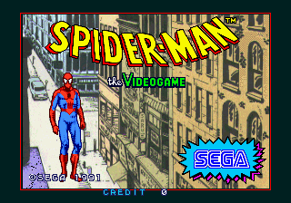
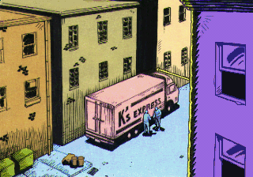

# Spider-Man: The Videogame ??? native recompilation

A native, ROM-free reconstruction of Sega's 1991 arcade game **Spider-Man: The
Videogame** (Sega System 32, 4-player board) for Windows x64 and Linux x86_64
(Steam Deck).

The V60 main program is **statically translated to C**, one original instruction at a
time, and compiled to native machine code. There is no V60 interpreter in the game.
The System 32 board is modelled in C: memory map, interrupt controller, timers,
315-5296 I/O, the 4-player 8255 PPI, EEPROM, palette/mixer registers, the video
hardware, and the RF5C68/YM3438 sound chips.

The **sound CPU is the one emulated component**: the original Z80 driver currently
runs on MAME's Z80 core (BSD-3-Clause) as a documented fallback until its native
translation is complete. The main game logic is native. See
[BUILD_STATUS.md](BUILD_STATUS.md).

The repository contains **no game data**. You supply your own legally obtained MAME
`spidman.zip`; the game verifies it by CRC32 and lays the ROMs out as the board does.
No executable carries the ROM or any extracted graphics, audio or program bytes.

> This is an unofficial preservation and research project. It is not affiliated with
> or endorsed by Sega or Marvel. Spider-Man is a trademark of Marvel Characters, Inc.

<p align="center">
  
  
</p>
<p align="center"><sub>Frames drawn by the game's own video library while the translated program plays
the test scripts. These screenshots are from authorized local test runs; no ROM is included.</sub></p>

## Status

| Area | Status |
|---|---|
| ROM verification (MAME set `spidman`, 20 files, CRC32 + SHA-1) | **Working** ??? 20/20 |
| V60 disassembly and control-flow analysis | **Working** ??? 6,273 distinct instructions, 718 functions, no invalid/overlapping paths |
| Native V60 translation (instruction-level C) | **Working** ??? 16,442 instructions written |
| Board model (memory, IRQ, timers, I/O, PPI, EEPROM, video) | **Working** |
| Frame-for-frame comparison with MAME (`s32ref`) | **Passing** ??? state and picture identical for 1,500 attract frames and 900 coin/start/gameplay frames |
| SDL2 window, keyboard, 4 game controllers | **Working** (Windows build tested) |
| Windows x64 `.exe` | **Built and run** |
| Linux x86_64 / Steam Deck AppImage | **Built and verified** in WSL2 Ubuntu 22.04; AppImage runs with the ROM. Physical Steam Deck hardware not available for testing |
| Sound | **Working via a documented fallback** ??? the original Z80 program runs on MAME's Z80 core with MAME's RF5C68 and ymfm's YM3438 (BSD-3-Clause). This sound CPU is **emulated**, not native; the native Z80 translation is the next step. Sound is verified to produce non-silent output in gameplay |
| Readable high-level C | **Partial** ??? the decompiler stops on an unidentified computed jump; the instruction-level translation is the functional build |
| ROM-free release | **Prepared** ??? no ROM data in the tree; release artifacts contain only code |

The full, honest build/test record is in [BUILD_STATUS.md](BUILD_STATUS.md).

## Requirements

- Python 3.10+
- CMake 3.20+
- A C11/C++17 compiler (MinGW-w64 GCC or MSVC on Windows; GCC/Clang on Linux)
- SDL2 development files (for the windowed game)
- `git` (for the `tools/core` submodule)

On Windows this project was built with **MSYS2 MinGW-w64 GCC 16.2** and the MSYS2
SDL2 package. Visual Studio 2022 Build Tools are also supported by CMake.

## Getting the toolkit

The decompiler and analysis tools are [arcade-decomp](https://github.com/cheviman/arcade-decomp),
kept in `tools/core/` as a Git submodule:

```bash
git clone --recursive <this repository>
# or, in an existing clone:
git submodule update --init
```

The project carries a small patch for the core (`tools/core-spidman.patch`: frame waits
on a flag bit, ROM-mirror frame loops, SCHCU/SKPCU halfwords, Z80 IM 2 and `(C)` port
I/O). Apply it once:

```bash
python tools/setup_core.py
```

## ROM set

Put MAME's `spidman.zip` (or its 20 files) in `rom/`, or pass a `.zip`/folder to the
tools. Verify it:

```bash
python tools/verify_rom.py rom
```

Expected: `20/20 files of the 'spidman' set`.

The game also accepts:

- `SPIDERMAN_ROM=/path/to/spidman.zip`, or
- `spidman.zip` beside the executable, or
- `rom/spidman.zip` in the current directory.

The runtime checks every file by CRC32 before using it. A wrong revision, a renamed
file or an incomplete set is rejected with the missing file's name.

## Build ??? Windows x64

From a shell where CMake, Python and the compiler are on `PATH`:

```powershell
.\build_windows.ps1
```

The script verifies the toolchain and the ROM, configures CMake with Ninja, builds,
and reports errors. It also runs `tools/recompile.py` first, which writes the
translated program into `build/generated/` from your ROM. A manual build:

```powershell
python tools\recompile.py rom
cmake -S . -B build/cmake -G Ninja -DCMAKE_BUILD_TYPE=Release `
  -DCMAKE_C_COMPILER=C:/msys64/mingw64/bin/gcc.exe `
  -DCMAKE_CXX_COMPILER=C:/msys64/mingw64/bin/g++.exe
cmake --build build/cmake
```

Outputs in `build/bin/`:

- `spidman.exe` ??? the game (SDL2, `SDL2.dll` copied beside it)
- `spidman_headless.exe` ??? deterministic test runner, no window
- `s32ref.exe` ??? reference: the original V60 program on MAME's core, for comparisons
- `oracle.exe`, `oracle_z80.exe` ??? MAME disassembler oracles

Run the game with `spidman.zip` beside `spidman.exe`, or set `SPIDERMAN_ROM`.

## Build ??? Linux / Steam Deck AppImage

On Linux (or WSL/SteamOS):

```bash
bash build_appimage.sh
```

The script builds the Linux binary, prepares an AppDir, downloads/uses
`appimagetool`, packages `SpiderMan-SteamDeck-x86_64.AppImage`, and verifies that it
runs. It requires `cmake`, a C/C++ compiler, `libsdl2-dev`, Python 3 and `curl`/`wget`.
The AppImage is built **on Linux**; a Windows `.exe` is never repackaged.

Steam Deck notes:

- The built-in controller is player 1; additional controllers are players 2-4.
- Desktop Mode: run the AppImage directly.
- Gaming Mode: add it as a non-Steam game. No root privileges are needed.
- The game writes `spidman.eeprom` and `spidman.ini` to the user's data folder
  (`~/.local/share/SpiderMan/`).

## Controls

The arcade panel has four players. Defaults:

| | Player 1 | Player 2 | Player 3 | Player 4 |
|---|---|---|---|---|
| Move | Arrow keys | W A S D | I J K L | Keypad 8 4 5 6 |
| Button 1 | Z / Space | Q | U | Keypad 7 |
| Button 2 | X | E | O | Keypad 9 |
| Start | 1 | 2 | 3 | 4 |
| Coin | 5 | 6 | 7 | 8 |

Common keys: **9** service, **F2** test mode, **F11** / **Alt+Enter** full screen,
**F3** smooth/sharp pixels, **Escape** quit.

Game controllers (Xbox-compatible, Steam Deck): one controller per player. Left stick
or D-pad moves, **A** = button 1, **B** = button 2, **Start** = start, **Back** = coin.
The Steam Deck's built-in controls appear as player 1.

Full details and configuration: [docs/CONTROLS.md](docs/CONTROLS.md).

## Tests

```bash
python tests/run_tests.py
```

The test runner:

1. verifies the ROM set;
2. builds the native program and the reference;
3. runs the attract-mode and coin/start/gameplay scripts on both;
4. compares the board-state hash and the picture hash **frame by frame**;
5. reports the first differing frame, if any.

Individual runs:

```bash
build/bin/spidman_headless.exe --script tests/controls/coin_start.txt --hashes out.txt --video-hashes video.txt
build/bin/s32ref.exe --timing frames --script tests/controls/coin_start.txt --hashes ref.txt --video-hashes ref_video.txt --rom rom
```

`tests/controls/*.txt` is a small frame-based control language (coins, starts,
directions, buttons, DIP switches and memory pokes); see `runtime/include/s32/script.h`.

## Project layout

```text
CMakeLists.txt              build of the runtime, the game, the reference and the ports
src/                        generated/readable game C (tools/decompile.py; partial)
tools/core/                 arcade-decomp submodule (BSD-3-Clause)
tools/spidman_rom.py        MAME 'spidman' set definition and region builders
tools/game_profile.py       what the decompiler core needs to know of this game
tools/recompile.py          wrapper: V60 instruction-level translation
tools/decompile.py          wrapper: high-level C decompiler
tools/reference/            MAME V60/Z80/video/sound reference (BSD-3-Clause)
runtime/                    System 32 board model, video, sound chips, ROM loader
ports/headless/             deterministic test runner
ports/sdl2/                 window, controls, audio, settings
tests/controls/             control scripts
packaging/                  Windows and AppImage packaging
docs/                       ROM analysis, controls, architecture, build status
```

## How it works

1. `tools/disassemble.py` recursively disassembles the V60 program from the reset
   vector and the interrupt vectors.
2. `tools/recompile.py` splits it into functions and writes C for every instruction
   (`build/generated/`). The C keeps the V60 registers and flags, but is ordinary C
   compiled by the host compiler ??? the CPU is not interpreted.
3. `runtime/src/v60.c` provides the multi-instruction helpers (string moves, bit
   strings, searches, division, task switches, interrupts, frame timing).
4. `runtime/src/machine.c`, `io.c`, `video.c`, `sound*.c` model the board.
5. `ports/sdl2/main.c` presents the picture, reads four players, keeps 60 Hz, and
   saves the EEPROM/settings.
6. `tools/reference/s32ref.cpp` runs the **original** program on MAME's V60 core
   against the same board model, producing reference state/picture/sound hashes.

The static translation was extended with trace data from `s32ref` for code reached
only through computed jumps (the coin/start path). Re-run `tools/recompile.py` with
`--trace` after adding a new control script if the game reports
`No translated code starts at ...`.

## Limitations

- **The sound CPU is emulated, not native.** The main V60 program is native, but the Z80 driver
  runs on MAME's Z80 core with MAME's RF5C68 and ymfm's YM3438. This is a documented fallback
  (BSD-3-Clause, notices kept) until the native Z80 translation is finished. The decompiler
  currently stops on a `push` + `jp (hl)` command dispatch; see `BUILD_STATUS.md` for the exact
  blocker and plan. The reference tool has the same sound board, so sample-level comparison is
  available.
- The high-level decompiler (`tools/decompile.py`) does not complete on this program
  yet: `symbols.txt` needs the game's computed-jump tables and structure names. The
  instruction-level translation is complete and is what the game runs.
- The V60 boot writes 16 bytes to `0xE00000`, which MAME's System 32 map also leaves
  unmapped. Both the reference and the game log the same 16 unmapped writes.
- The Windows build was tested with MinGW-w64; MSVC is configured but not tested here.
- The AppImage must be built and tested on Linux/SteamOS; it is not produced on
  Windows.

## Licensing

Original project code: **PolyForm Noncommercial 1.0.0**. The arcade-decomp toolkit,
the System 32 runtime derived from segasonic-decomp, MAME/ymfm reference code and SDL2
keep their own licenses (BSD-3-Clause / zlib). See [LICENSE](LICENSE) and the headers
of each file. No ROM or game data is licensed or distributed here.

## Credits

- **arcade-decomp** and **segasonic-decomp** by Sebastian Toyos (BSD-3-Clause) ??? the
  V60/Z80 tooling, decompiler, System 32 board model, video library, sound chips and
  SDL2 port structure.
- **MAME** (BSD-3-Clause) ??? System 32 documentation and drivers, V60/Z80 cores, video
  and RF5C68 reference.
- **ymfm** (BSD-3-Clause) ??? YM3438 reference.
- **SDL2** (zlib) ??? window, input, audio.


